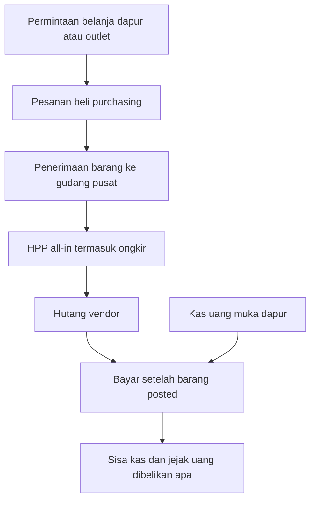
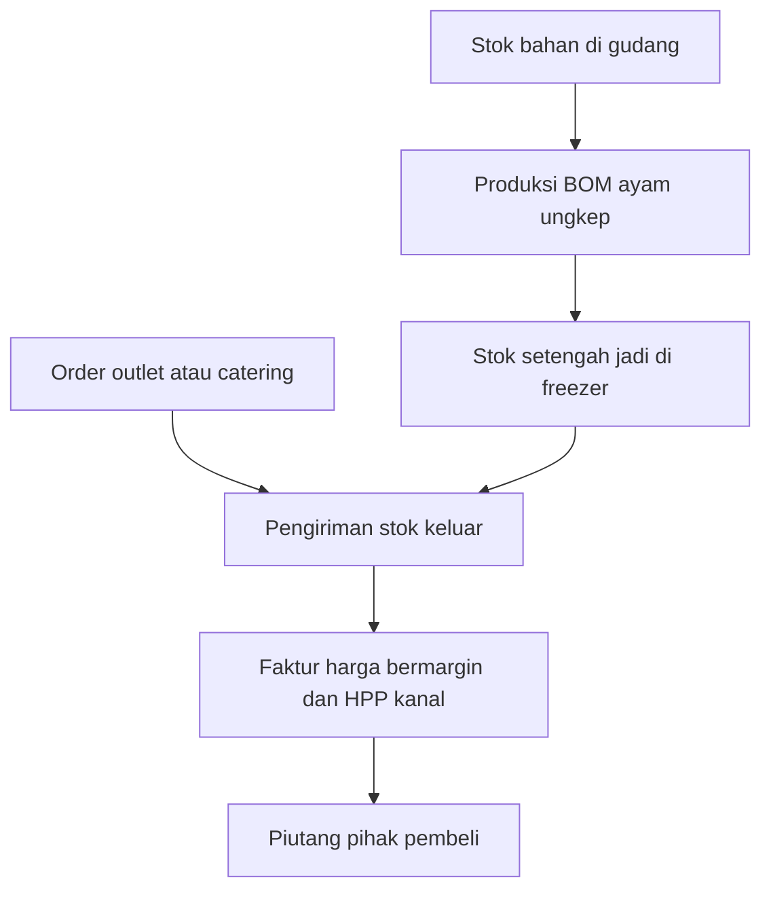

# Modul Stok dan HPP — ERP Ayam Bakar Pucuk Singkong

**Versi:** 0.1
**Tanggal:** 9 November 2026
**Status:** Spesifikasi saja. Bukan migrasi dan bukan seed yang dijalankan.
**Peran:** hanya `superadmin`
**Acuan narasi:** Google Doc *Erp abs stok*, butir belanja satu gudang sampai hutang vendor
**Konsisten dengan:** `refs/prd.md`, `refs/erd.md`, `refs/trd.md`, `AGENTS.md`

Dokumen ini tidak mengubah `lib/db/migrations/0000_init.sql`, `drizzle/seed.ts`, atau kode aplikasi. Rilis absensi dan payroll tetap tanpa tabel stok. Angka di bagian seed bertanda **CONTOH**. Bukan harga pasar dan bukan data pribadi.

Label **Wajib** tidak boleh dimatikan. Label **Default** hidup di `setting_values` dengan `effective_from` / `effective_to`, sama seperti aturan payroll.

---

## 1. Ringkasan dan tujuan

Dapur pusat belanja harian lewat satu gudang, menyimpan bahan, mengolah sebagian menjadi barang setengah jadi, lalu menjual ke outlet dan catering dengan harga yang sudah ada marginnya. Modul ini menjawab pertanyaan yang sekarang mandek di pembukuan:

- uang yang diterima dapur dibelikan apa;
- hutang vendor mana yang harus dibayar hari ini, dan hanya setelah barang datang;
- stok gudang dan freezer tinggal berapa, nilai HPP-nya berapa;
- outlet memakai HPP berapa, catering memakai HPP berapa;
- jual ke outlet dan ke catering untung atau merugi.

Outlet ke depan bisa milik pihak lain. Karena itu outlet internal dan outlet pihak ketiga adalah pihak yang berbeda, dengan harga jual dan laporan laba yang terpisah. Keduanya tetap beli ke gudang pusat, bukan belanja sendiri ke vendor.

---

## 2. Scope

### 2.1 Masuk spesifikasi ini

- Rencana belanja dari dapur atau outlet, diteruskan ke purchasing.
- Pesanan beli ke vendor, penerimaan barang, hutang, dan bayar setelah barang masuk.
- Kas uang muka dapur dan realisasi belanja atas uang itu.
- Stok masuk gudang, pindah ke freezer, konversi produksi, stok keluar.
- HPP all-in, termasuk ongkir yang dialokasikan.
- Harga jual bermargin ke outlet dan catering.
- Pengiriman, faktur, dan piutang pusat ke outlet atau catering.
- Laporan stok, kartu stok, HPP per kanal, laba penjualan, kas versus realisasi, jadwal bayar, dan selisih opname.
- Konsep outlet pihak ketiga sebagai pelanggan, tanpa akses ke sistem.

### 2.2 Di luar spesifikasi ini

- Absensi, shift, kasbon, slip, dan payroll. Tidak ada FK ke `employees`.
- Pajak masukan, jurnal akuntansi umum, dan neraca lengkap.
- POS MOKA, Runchise, atau Kledo.
- Multi-gudang beli. Belanja tercatat sekali di gudang pusat.
- Stok negatif sebagai keadaan normal.
- Role baru untuk purchasing, dapur, atau gudang.

---

## 3. Aktor dan izin

Hanya pengguna `users.role = superadmin` yang boleh membaca atau mengubah modul ini.

| Aktor bisnis | Disimpan sebagai | Bukan |
|---|---|---|
| Tim dapur | `source_unit = dapur` pada permintaan atau produksi | role |
| Tim outlet | `source_unit = outlet` pada permintaan | role |
| Tim purchasing | `source_unit = purchasing` pada pesanan beli | role |
| Gudang / freezer | baris `stock_bins` | role |
| Outlet internal, outlet pihak ketiga, katering, vendor | baris `stock_parties` | role |

`superordinat` dan `subordinat` tidak punya menu, tidak punya izin `read`, dan tidak menerima data lewat API. Menyembunyikan menu tidak cukup.

**Wajib** di setiap handler `app/api/{model}/route.ts`:

1. `getServerSession()`.
2. `checkPermission(role, resource, action)` dengan resource bertanda `stock_*`.
3. Jika role bukan `superadmin`, tolak `403` sebelum query daftar.
4. Jangan longgarkan lewat query `location_id` atasan. Isolasi stok tidak mengikuti bawahan HRD.

`lib/auth/rbac.ts` untuk resource stok hanya mengizinkan `superadmin`. Dua peran lain tidak mendapat `read`, `create`, `update`, atau `approve` pada resource itu.

Mutasi menulis `audit_logs` (`entity_type` nama tabel, `entity_id` dokumen). Tabel audit tetap append-only dan tanpa kolom donatur.

---

## 4. Alur

### 4.1 Belanja harian sampai hutang



### 4.2 Produksi, simpan, jual



Satu siklus contoh di bagian 10 memakai kedua alur ini.

**Wajib:** penerimaan pembelian hanya masuk bin gudang pusat. Outlet tidak membuat penerimaan vendor.

**Wajib:** pembayaran vendor hanya untuk penerimaan yang sudah `posted`. Tidak ada uang keluar sebelum barang tercatat masuk.

---

## 5. HPP

**Default** metode `moving_average`, disimpan di setting `stock.hpp_method`. Opsi lain `fifo`. Keduanya bertanggal. Dokumen yang sudah `posted` menyimpan metode dan biaya satuan di barisnya, bukan membaca ulang setting hidup.

**Default** alokasi ongkir dan biaya lain `by_value`: biaya tambahan dibagi menurut nilai barang di penerimaan yang sama. Opsi `by_qty` dan `none` ada di setting `stock.freight_allocation`.

HPP all-in satu baris penerimaan:

`nilai_barang + bagian_ongkir + bagian_biaya_lain`

Biaya satuan = nilai all-in dibagi kuantitas diterima, dalam satuan stok.

Saat metode rata-rata bergerak, penerimaan baru mengubah saldo:

`biaya_baru = (nilai_saldo + nilai_masuk) / (qty_saldo + qty_masuk)`

Pengeluaran memakai biaya satuan saldo saat itu dan tidak mengubah biaya satuan sisa.

Produksi menggulung HPP: jumlah nilai bahan yang dikonsumsi, plus biaya lain pada perintah produksi bila ada, dibagi kuantitas hasil. Contoh di bagian 10 tidak menambah biaya tenaga. Tenaga tetap di payroll, tidak di HPP barang, sampai ada setting terpisah yang sengaja diisi. **Default** `stock.roll_labor_into_hpp = false`.

**Default** `stock.allow_negative = false`. Stok tidak boleh melewati nol. Koreksi kekurangan lewat opname yang posted, bukan lewat penjualan yang memaksa saldo minus.

---

## 6. Menu dan layar

Hanya `superadmin`. Route mengikuti `app/api/{model}/route.ts` dan halaman di `app/(dashboard)/` tanpa folder baru di luar pola TRD.

| Menu | Layar | API |
|---|---|---|
| Stok | Barang, satuan, kategori, resep | `/api/stock-items`, `/api/stock-uoms`, `/api/stock-boms` |
| Stok | Bin gudang dan freezer | `/api/stock-bins` |
| Stok | Pihak: vendor, outlet, katering | `/api/stock-parties` |
| Stok | Daftar harga margin | `/api/stock-price-lists` |
| Pembelian | Permintaan belanja | `/api/purchase-requests` |
| Pembelian | Pesanan beli | `/api/purchase-orders` |
| Pembelian | Penerimaan | `/api/goods-receipts` |
| Pembelian | Hutang dan pembayaran vendor | `/api/vendor-bills`, `/api/vendor-payments` |
| Kas dapur | Uang muka dan realisasi | `/api/cash-funds` |
| Produksi | Perintah produksi | `/api/production-orders` |
| Penjualan | Order outlet atau katering | `/api/sales-orders` |
| Penjualan | Pengiriman dan faktur | `/api/shipments`, `/api/sales-invoices` |
| Stok | Kartu stok, saldo, opname | `/api/stock-moves`, `/api/stock-counts` |
| Laporan | Nilai stok, HPP kanal, laba, kas, jadwal bayar | `/api/stock-reports` |

Dokumen berstatus `draft` atau `posted`. Yang sudah `posted` tidak diubah. Salah posting diperbaiki dengan dokumen pembalik yang menunjuk dokumen asal dan membalik kuantitas serta nilai. Pembalik juga `posted` dan diaudit.

---

## 7. Laporan

| Laporan | Isi |
|---|---|
| Nilai persediaan | Kuantitas dan nilai per barang per bin, metode yang tersimpan di saldo |
| Kartu stok | Setiap `stock_moves` suatu barang: masuk, keluar, saldo berjalan, nilai |
| HPP per kanal | Jumlah HPP pengiriman ke `internal_outlet`, `third_party_outlet`, dan `catering` |
| Laba penjualan pusat | Omzet faktur minus HPP, per pihak pembeli |
| Kas versus realisasi | Uang muka masuk, belanja yang menutup penerimaan, sisa kas |
| Jadwal bayar hari ini | Hutang `open` yang `due_date` sampai hari ini, hanya yang penerimaannya sudah `posted` |
| Selisih opname | Kuantitas hitung versus saldo, nilai selisih memakai biaya satuan saat posting |

---

## 8. Aturan

1. **Wajib** satu gudang penerimaan untuk pembelian.
2. **Wajib** bayar vendor hanya setelah penerimaan `posted` dan nilai bayar tidak melebihi sisa hutang.
3. **Wajib** stok tidak minus bila `stock.allow_negative` mati. Default mati.
4. **Wajib** dokumen `posted` tidak di-update. Koreksi lewat pembalik.
5. **Wajib** harga jual faktur menyalin daftar harga yang berlaku pada tanggal kirim, lalu disimpan di baris faktur.
6. **Wajib** outlet pihak ketiga tidak punya `users`. Mereka hanya `stock_parties.party_kind = third_party_outlet`.
7. **Default** HPP rata-rata bergerak. **Default** ongkir dialokasi menurut nilai barang.
8. **Default** margin contoh: outlet 20 persen, katering 30 persen. Keduanya setting, bukan konstanta kode.
9. Resep menyimpan kuantitas bahan per kuantitas hasil. Perintah produksi menyalin resep saat posting.
10. Uang muka dapur tidak otomatis menjadi HPP. HPP naik dari penerimaan barang. Kas hanya mencatat uang keluar yang melunasi hutang atau belanja tunai yang sudah punya penerimaan.

---

## 9. Skema yang diusulkan

Belum masuk migrasi. Tipe mengikuti ERD HRD: `BIGSERIAL`, `VARCHAR` untuk status, `TIMESTAMPTZ`, `NUMERIC` untuk uang dan kuantitas. Soft delete `deleted_at` hanya pada master. Dokumen transaksi tidak dihapus.

Pakai ulang, tanpa kolom baru yang mengubah arti HRD:

| Tabel yang sudah ada | Pemakaian stok |
|---|---|
| `org_profile` | Satu lembaga. Tidak ada `tenant_id` |
| `users` | `created_by` / `posted_by`. Hanya `superadmin` yang lolos API |
| `audit_logs` | Jejak mutasi |
| `locations` | Tempat fisik bila bin atau pihak memang di lokasi absensi. `locations.code = DAPUR_PUSAT` untuk gudang dan freezer. `OUTLET_BAROS` untuk outlet internal bila baris itu ada. Absensi tidak membaca stok |
| `setting_definitions`, `setting_values`, `approval_policies` | Setting HPP dan margin. Jangan buat registry kedua |

### 9.1 Master

```sql
CREATE TABLE stock_uoms (
    id          BIGSERIAL PRIMARY KEY,
    code        VARCHAR(20)  NOT NULL UNIQUE,
    name        VARCHAR(100) NOT NULL,
    deleted_at  TIMESTAMPTZ
);

CREATE TABLE stock_item_categories (
    id          BIGSERIAL PRIMARY KEY,
    code        VARCHAR(50)  NOT NULL UNIQUE,
    name        VARCHAR(200) NOT NULL,
    deleted_at  TIMESTAMPTZ
);

CREATE TABLE stock_items (
    id              BIGSERIAL PRIMARY KEY,
    sku             VARCHAR(50)  NOT NULL UNIQUE,
    name            VARCHAR(200) NOT NULL,
    category_id     BIGINT       NOT NULL REFERENCES stock_item_categories(id),
    uom_id          BIGINT       NOT NULL REFERENCES stock_uoms(id),
    item_kind       VARCHAR(30)  NOT NULL,
      -- material | semi_finished | finished
    is_stocked      BOOLEAN      NOT NULL DEFAULT TRUE,
    deleted_at      TIMESTAMPTZ
);
CREATE INDEX idx_stock_items_kind ON stock_items(item_kind) WHERE deleted_at IS NULL;

CREATE TABLE stock_bins (
    id           BIGSERIAL PRIMARY KEY,
    code         VARCHAR(50)  NOT NULL UNIQUE,
    name         VARCHAR(200) NOT NULL,
    bin_kind     VARCHAR(30)  NOT NULL,
      -- receiving | storage | production
    location_id  BIGINT       REFERENCES locations(id),
    is_receiving BOOLEAN      NOT NULL DEFAULT FALSE,
    deleted_at   TIMESTAMPTZ,
    CONSTRAINT ck_one_receiving CHECK (
        is_receiving = FALSE OR bin_kind = 'receiving'
    )
);
CREATE UNIQUE INDEX uq_stock_one_receiving
    ON stock_bins(is_receiving) WHERE is_receiving = TRUE AND deleted_at IS NULL;

CREATE TABLE stock_parties (
    id            BIGSERIAL PRIMARY KEY,
    code          VARCHAR(50)  NOT NULL UNIQUE,
    name          VARCHAR(200) NOT NULL,
    party_kind    VARCHAR(30)  NOT NULL,
      -- vendor | internal_outlet | third_party_outlet | catering
    location_id   BIGINT       REFERENCES locations(id),
    deleted_at    TIMESTAMPTZ
);

CREATE TABLE stock_boms (
    id               BIGSERIAL PRIMARY KEY,
    output_item_id   BIGINT        NOT NULL REFERENCES stock_items(id),
    output_qty       NUMERIC(18,6) NOT NULL CHECK (output_qty > 0),
    effective_from   DATE          NOT NULL,
    effective_to     DATE,
    CONSTRAINT ck_bom_range CHECK (effective_to IS NULL OR effective_to > effective_from)
);

CREATE TABLE stock_bom_lines (
    id          BIGSERIAL PRIMARY KEY,
    bom_id      BIGINT        NOT NULL REFERENCES stock_boms(id),
    item_id     BIGINT        NOT NULL REFERENCES stock_items(id),
    qty         NUMERIC(18,6) NOT NULL CHECK (qty > 0),
    CONSTRAINT uq_bom_item UNIQUE (bom_id, item_id)
);

CREATE TABLE stock_price_lists (
    id              BIGSERIAL PRIMARY KEY,
    code            VARCHAR(50) NOT NULL UNIQUE,
    party_kind      VARCHAR(30) NOT NULL,
    margin_percent  NUMERIC(8,4) NOT NULL,
    effective_from  DATE        NOT NULL,
    effective_to    DATE
);
```

Harga satuan faktur = HPP satuan saat kirim dikali `1 + margin_percent / 100`, lalu disimpan. Mengubah daftar harga tidak mengubah faktur posted.

### 9.2 Pembelian, kas, hutang

```sql
CREATE TABLE purchase_requests (
    id            BIGSERIAL PRIMARY KEY,
    doc_no        VARCHAR(40) NOT NULL UNIQUE,
    source_unit   VARCHAR(30) NOT NULL,
      -- dapur | outlet
    status        VARCHAR(20) NOT NULL,
      -- draft | posted
    needed_on     DATE        NOT NULL,
    created_by    BIGINT      NOT NULL REFERENCES users(id),
    posted_at     TIMESTAMPTZ
);

CREATE TABLE purchase_request_lines (
    id          BIGSERIAL PRIMARY KEY,
    request_id  BIGINT        NOT NULL REFERENCES purchase_requests(id),
    item_id     BIGINT        NOT NULL REFERENCES stock_items(id),
    qty         NUMERIC(18,6) NOT NULL CHECK (qty > 0)
);

CREATE TABLE purchase_orders (
    id           BIGSERIAL PRIMARY KEY,
    doc_no       VARCHAR(40) NOT NULL UNIQUE,
    request_id   BIGINT      REFERENCES purchase_requests(id),
    vendor_id    BIGINT      NOT NULL REFERENCES stock_parties(id),
    status       VARCHAR(20) NOT NULL,
    source_unit  VARCHAR(30) NOT NULL DEFAULT 'purchasing',
    created_by   BIGINT      NOT NULL REFERENCES users(id),
    posted_at    TIMESTAMPTZ
);

CREATE TABLE purchase_order_lines (
    id          BIGSERIAL PRIMARY KEY,
    order_id    BIGINT        NOT NULL REFERENCES purchase_orders(id),
    item_id     BIGINT        NOT NULL REFERENCES stock_items(id),
    qty         NUMERIC(18,6) NOT NULL CHECK (qty > 0),
    price_hint  NUMERIC(18,2)
);

CREATE TABLE goods_receipts (
    id            BIGSERIAL PRIMARY KEY,
    doc_no        VARCHAR(40) NOT NULL UNIQUE,
    order_id      BIGINT      NOT NULL REFERENCES purchase_orders(id),
    bin_id        BIGINT      NOT NULL REFERENCES stock_bins(id),
    status        VARCHAR(20) NOT NULL,
    hpp_method    VARCHAR(30) NOT NULL,
    freight_cost  NUMERIC(18,2) NOT NULL DEFAULT 0,
    other_cost    NUMERIC(18,2) NOT NULL DEFAULT 0,
    created_by    BIGINT      NOT NULL REFERENCES users(id),
    posted_at     TIMESTAMPTZ,
    CONSTRAINT ck_grn_receiving CHECK (status <> 'posted' OR posted_at IS NOT NULL)
);

CREATE TABLE goods_receipt_lines (
    id              BIGSERIAL PRIMARY KEY,
    receipt_id      BIGINT        NOT NULL REFERENCES goods_receipts(id),
    item_id         BIGINT        NOT NULL REFERENCES stock_items(id),
    qty             NUMERIC(18,6) NOT NULL CHECK (qty > 0),
    goods_value     NUMERIC(18,2) NOT NULL,
    allocated_extra NUMERIC(18,2) NOT NULL DEFAULT 0,
    all_in_value    NUMERIC(18,2) NOT NULL,
    unit_cost       NUMERIC(18,6) NOT NULL,
    CONSTRAINT ck_all_in CHECK (all_in_value = goods_value + allocated_extra)
);

CREATE TABLE vendor_bills (
    id           BIGSERIAL PRIMARY KEY,
    doc_no       VARCHAR(40) NOT NULL UNIQUE,
    receipt_id   BIGINT      NOT NULL UNIQUE REFERENCES goods_receipts(id),
    vendor_id    BIGINT      NOT NULL REFERENCES stock_parties(id),
    amount       NUMERIC(18,2) NOT NULL CHECK (amount > 0),
    amount_open  NUMERIC(18,2) NOT NULL,
    due_date     DATE        NOT NULL,
    status       VARCHAR(20) NOT NULL,
      -- open | paid
    CONSTRAINT ck_bill_open CHECK (amount_open >= 0 AND amount_open <= amount)
);

CREATE TABLE vendor_payments (
    id          BIGSERIAL PRIMARY KEY,
    doc_no      VARCHAR(40) NOT NULL UNIQUE,
    bill_id     BIGINT      NOT NULL REFERENCES vendor_bills(id),
    amount      NUMERIC(18,2) NOT NULL CHECK (amount > 0),
    paid_on     DATE        NOT NULL,
    fund_id     BIGINT      REFERENCES cash_funds(id),
    status      VARCHAR(20) NOT NULL,
    created_by  BIGINT      NOT NULL REFERENCES users(id)
);

CREATE TABLE cash_funds (
    id          BIGSERIAL PRIMARY KEY,
    code        VARCHAR(50) NOT NULL UNIQUE,
    name        VARCHAR(200) NOT NULL,
    balance     NUMERIC(18,2) NOT NULL DEFAULT 0,
    CONSTRAINT ck_fund_nonneg CHECK (balance >= 0)
);

CREATE TABLE cash_fund_entries (
    id          BIGSERIAL PRIMARY KEY,
    fund_id     BIGINT      NOT NULL REFERENCES cash_funds(id),
    entry_kind  VARCHAR(20) NOT NULL,
      -- topup | spend
    amount      NUMERIC(18,2) NOT NULL CHECK (amount > 0),
    memo        TEXT        NOT NULL,
    payment_id  BIGINT      REFERENCES vendor_payments(id),
    created_by  BIGINT      NOT NULL REFERENCES users(id),
    created_at  TIMESTAMPTZ NOT NULL DEFAULT now()
);
```

`cash_funds.balance` hanya boleh berubah lewat posting entri kas, dalam transaksi yang sama dengan entri itu.

### 9.3 Gerakan stok, produksi, jual

```sql
CREATE TABLE stock_balances (
    id          BIGSERIAL PRIMARY KEY,
    item_id     BIGINT        NOT NULL REFERENCES stock_items(id),
    bin_id      BIGINT        NOT NULL REFERENCES stock_bins(id),
    qty         NUMERIC(18,6) NOT NULL,
    value       NUMERIC(18,2) NOT NULL,
    unit_cost   NUMERIC(18,6) NOT NULL,
    CONSTRAINT uq_balance UNIQUE (item_id, bin_id),
    CONSTRAINT ck_balance_nonneg CHECK (qty >= 0 AND value >= 0)
);

CREATE TABLE stock_moves (
    id            BIGSERIAL PRIMARY KEY,
    item_id       BIGINT        NOT NULL REFERENCES stock_items(id),
    bin_id        BIGINT        NOT NULL REFERENCES stock_bins(id),
    move_kind     VARCHAR(30)   NOT NULL,
      -- receipt | consume | produce | ship | count | reversal
    qty           NUMERIC(18,6) NOT NULL,
    value         NUMERIC(18,2) NOT NULL,
    unit_cost     NUMERIC(18,6) NOT NULL,
    source_type   VARCHAR(40)   NOT NULL,
    source_id     BIGINT        NOT NULL,
    created_at    TIMESTAMPTZ   NOT NULL DEFAULT now()
);
CREATE INDEX idx_stock_moves_item ON stock_moves(item_id, bin_id, created_at);

CREATE TABLE production_orders (
    id            BIGSERIAL PRIMARY KEY,
    doc_no        VARCHAR(40) NOT NULL UNIQUE,
    bom_id        BIGINT      NOT NULL REFERENCES stock_boms(id),
    output_qty    NUMERIC(18,6) NOT NULL CHECK (output_qty > 0),
    output_bin_id BIGINT      NOT NULL REFERENCES stock_bins(id),
    status        VARCHAR(20) NOT NULL,
    total_cost    NUMERIC(18,2),
    created_by    BIGINT      NOT NULL REFERENCES users(id),
    posted_at     TIMESTAMPTZ
);

CREATE TABLE production_lines (
    id            BIGSERIAL PRIMARY KEY,
    order_id      BIGINT        NOT NULL REFERENCES production_orders(id),
    item_id       BIGINT        NOT NULL REFERENCES stock_items(id),
    bin_id        BIGINT        NOT NULL REFERENCES stock_bins(id),
    qty           NUMERIC(18,6) NOT NULL CHECK (qty > 0),
    value         NUMERIC(18,2) NOT NULL
);

CREATE TABLE sales_orders (
    id           BIGSERIAL PRIMARY KEY,
    doc_no       VARCHAR(40) NOT NULL UNIQUE,
    party_id     BIGINT      NOT NULL REFERENCES stock_parties(id),
    status       VARCHAR(20) NOT NULL,
    ordered_on   DATE        NOT NULL,
    created_by   BIGINT      NOT NULL REFERENCES users(id)
);

CREATE TABLE sales_order_lines (
    id        BIGSERIAL PRIMARY KEY,
    order_id  BIGINT        NOT NULL REFERENCES sales_orders(id),
    item_id   BIGINT        NOT NULL REFERENCES stock_items(id),
    qty       NUMERIC(18,6) NOT NULL CHECK (qty > 0)
);

CREATE TABLE shipments (
    id          BIGSERIAL PRIMARY KEY,
    doc_no      VARCHAR(40) NOT NULL UNIQUE,
    order_id    BIGINT      NOT NULL REFERENCES sales_orders(id),
    bin_id      BIGINT      NOT NULL REFERENCES stock_bins(id),
    status      VARCHAR(20) NOT NULL,
    shipped_on  DATE        NOT NULL,
    posted_at   TIMESTAMPTZ
);

CREATE TABLE shipment_lines (
    id           BIGSERIAL PRIMARY KEY,
    shipment_id  BIGINT        NOT NULL REFERENCES shipments(id),
    item_id      BIGINT        NOT NULL REFERENCES stock_items(id),
    qty          NUMERIC(18,6) NOT NULL CHECK (qty > 0),
    unit_cost    NUMERIC(18,6) NOT NULL,
    cogs_value   NUMERIC(18,2) NOT NULL
);

CREATE TABLE sales_invoices (
    id           BIGSERIAL PRIMARY KEY,
    doc_no       VARCHAR(40) NOT NULL UNIQUE,
    shipment_id  BIGINT      NOT NULL UNIQUE REFERENCES shipments(id),
    party_id     BIGINT      NOT NULL REFERENCES stock_parties(id),
    amount       NUMERIC(18,2) NOT NULL,
    cogs_amount  NUMERIC(18,2) NOT NULL,
    status       VARCHAR(20) NOT NULL,
    created_by   BIGINT      NOT NULL REFERENCES users(id)
);

CREATE TABLE sales_invoice_lines (
    id           BIGSERIAL PRIMARY KEY,
    invoice_id   BIGINT        NOT NULL REFERENCES sales_invoices(id),
    item_id      BIGINT        NOT NULL REFERENCES stock_items(id),
    qty          NUMERIC(18,6) NOT NULL,
    unit_cost    NUMERIC(18,6) NOT NULL,
    unit_price   NUMERIC(18,6) NOT NULL,
    line_amount  NUMERIC(18,2) NOT NULL,
    cogs_value   NUMERIC(18,2) NOT NULL
);

CREATE TABLE stock_counts (
    id          BIGSERIAL PRIMARY KEY,
    doc_no      VARCHAR(40) NOT NULL UNIQUE,
    bin_id      BIGINT      NOT NULL REFERENCES stock_bins(id),
    status      VARCHAR(20) NOT NULL,
    counted_on  DATE        NOT NULL,
    created_by  BIGINT      NOT NULL REFERENCES users(id)
);

CREATE TABLE stock_count_lines (
    id          BIGSERIAL PRIMARY KEY,
    count_id    BIGINT        NOT NULL REFERENCES stock_counts(id),
    item_id     BIGINT        NOT NULL REFERENCES stock_items(id),
    qty_system  NUMERIC(18,6) NOT NULL,
    qty_count   NUMERIC(18,6) NOT NULL,
    variance    NUMERIC(18,6) NOT NULL
);

CREATE TABLE stock_reversals (
    id            BIGSERIAL PRIMARY KEY,
    doc_no        VARCHAR(40) NOT NULL UNIQUE,
    source_type   VARCHAR(40) NOT NULL,
    source_id     BIGINT      NOT NULL,
    reason        TEXT        NOT NULL,
    created_by    BIGINT      NOT NULL REFERENCES users(id),
    posted_at     TIMESTAMPTZ NOT NULL DEFAULT now()
);
```

Saldo `stock_balances` berubah dalam transaksi yang sama dengan `stock_moves`. Jika `stock.allow_negative` mati, constraint `ck_balance_nonneg` menolak posting.

Setting yang ditambahkan ke registry yang sudah ada:

| Kunci | Default | Tipe |
|---|---|---|
| `stock.hpp_method` | `moving_average` | enum `moving_average`, `fifo` |
| `stock.freight_allocation` | `by_value` | enum `by_value`, `by_qty`, `none` |
| `stock.allow_negative` | `false` | boolean |
| `stock.roll_labor_into_hpp` | `false` | boolean |
| `stock.margin.internal_outlet` | `20` | persen, **CONTOH** |
| `stock.margin.third_party_outlet` | `20` | persen, **CONTOH** |
| `stock.margin.catering` | `30` | persen, **CONTOH** |

---

## 10. Seed contoh yang saling terkait

Semua angka **CONTOH**. Nama pihak generik. Tidak ada NIK, HP, atau rekening. Pengguna posting adalah satu `superadmin` yang sudah ada. Tidak ada password di seed ini.

### 10.1 Master

| Kode | Isi |
|---|---|
| Satuan `KG` | Kilogram |
| Kategori `BAHAN`, `OLAHAN` | Bahan baku dan setengah jadi |
| `AYAM_UTUH` | Bahan, kg |
| `BUMBU` | Bahan, kg |
| `AYAM_UNGKEP` | Setengah jadi, kg |
| Bin `GUDANG` | `is_receiving = true`, `location` = `DAPUR_PUSAT` |
| Bin `FREEZER` | penyimpanan, `location` = `DAPUR_PUSAT` |
| `VENDOR_CONTOH` | Vendor bahan |
| `OUTLET_INTERNAL` | Outlet internal, lokasi `OUTLET_BAROS` bila baris lokasi itu ada |
| `OUTLET_MITRA` | `third_party_outlet`, tanpa user, tanpa gerakan pada siklus ini |
| `CATERING` | Kanal katering |
| Resep | 10 kg `AYAM_UNGKEP` dari 12 kg `AYAM_UTUH` dan 0,4 kg `BUMBU`, berlaku 2026-11-09 |
| Harga | Outlet internal dan mitra margin 20 persen. Katering 30 persen |

### 10.2 Satu siklus

1. Permintaan `PR-CONTOH` dari `source_unit = dapur`: 20 kg ayam utuh dan 2 kg bumbu.
2. Pesanan `PO-CONTOH` ke `VENDOR_CONTOH` oleh `source_unit = purchasing`.
3. Kas `KAS_DAPUR` menerima uang muka **2.000.000**.
4. Penerimaan `GRN-CONTOH` ke bin `GUDANG`, metode `moving_average`, ongkir **32.000** dialokasi menurut nilai.

| Barang | Qty | Nilai barang | Bagian ongkir | All-in | Biaya / kg |
|---|---:|---:|---:|---:|---:|
| Ayam utuh | 20 | 600.000 | 30.000 | 630.000 | 31.500 |
| Bumbu | 2 | 40.000 | 2.000 | 42.000 | 21.000 |
| Jumlah |  | 640.000 | 32.000 | 672.000 |  |

Bagian ongkir ayam = 32.000 kali 600.000 / 640.000 = 30.000. Bumbu = 2.000.

5. Hutang `BILL-CONTOH` sebesar **672.000**, jatuh tempo pada tanggal penerimaan, status awal `open`.
6. Bayar `PAY-CONTOH` **672.000** dari `KAS_DAPUR` setelah GRN `posted`. Sisa kas **1.328.000**. Sisa hutang **0**.
7. Produksi `MO-CONTOH` hasil 10 kg ke `FREEZER`.

| Pemakaian | Qty | Nilai |
|---|---:|---:|
| Ayam utuh dari gudang | 12 | 378.000 |
| Bumbu dari gudang | 0,4 | 8.400 |
| Hasil ungkep | 10 | 386.400 |

Biaya hasil = 386.400 / 10 = **38.640** per kg.

8. Order dan kirim.

| Dokumen | Pihak | Qty | HPP satuan | HPP | Harga | Omzet | Laba |
|---|---|---:|---:|---:|---:|---:|---:|
| `SO-OUT` / `INV-OUT` | Outlet internal | 4 | 38.640 | 154.560 | 46.368 | 185.472 | 30.912 |
| `SO-CAT` / `INV-CAT` | Katering | 3 | 38.640 | 115.920 | 50.232 | 150.696 | 34.776 |

Harga outlet = 38.640 kali 1,20. Harga katering = 38.640 kali 1,30.

`OUTLET_MITRA` tidak punya order pada siklus ini. Laporannya nol, bukan angka tiruan.

### 10.3 Saldo akhir yang harus cocok

| Barang | Bin | Qty | Nilai |
|---|---|---:|---:|
| Ayam utuh | Gudang | 8 | 252.000 |
| Bumbu | Gudang | 1,6 | 33.600 |
| Ayam ungkep | Freezer | 3 | 115.920 |
| Jumlah persediaan |  |  | **401.520** |

Kas dapur **1.328.000**. Hutang vendor **0**. Piutang tercatat **336.168** dan belum dilunasi pada contoh ini.

Cek silang:

- Uang keluar 672.000 = nilai all-in penerimaan.
- HPP keluar 154.560 + 115.920 = 270.480.
- Persediaan sisa 401.520 + HPP keluar 270.480 = 672.000.
- Laba 30.912 + 34.776 = 65.688.
- Omzet 185.472 + 150.696 = 336.168.
- Omzet minus laba = 270.480 = HPP keluar.

Qty ayam 20 − 12 = 8. Bumbu 2 − 0,4 = 1,6. Ungkep 10 − 4 − 3 = 3.

---

## 11. Keterkaitan dengan HRD

| Modul HRD | Hubungan |
|---|---|
| `employees`, shift, absensi, cuti, lembur | Tidak ada |
| Kelompok gaji, slip, kasbon, kontrak | Tidak ada |
| `locations` | Hanya sebagai alamat fisik bin atau outlet internal |
| `users` / `audit_logs` / `org_profile` | Dipakai untuk pelaku superadmin dan jejak |
| Setting dan approval | Registry yang sama, kunci `stock.*` terpisah dari kunci payroll |
| Payroll | Upah tidak masuk HPP pada default |

Tidak ada laporan stok yang membaca menit telat, dan tidak ada payroll yang membaca saldo gudang.
